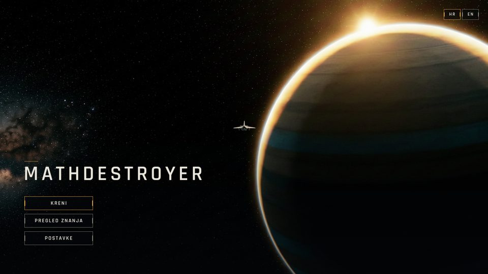
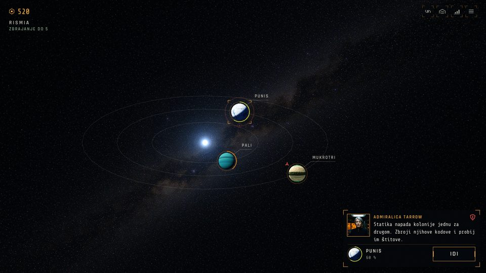
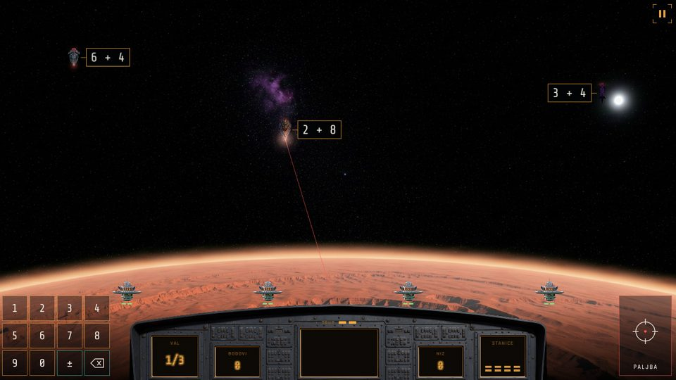
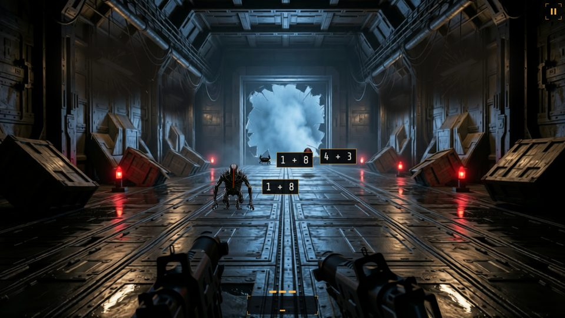

# MathDestroyer

Space defence game for practising maths. Enemy ships carry problems; type the answer to shoot them down before they hit your stations.

**[Play in the browser](https://vbachler.github.io/MathDestroyer/)** · **[Download for Windows](https://github.com/vbachler/MathDestroyer/releases/latest)**



| Star map | Battle | Boarding |
|---|---|---|
|  |  |  |

- Addition, subtraction, multiplication, division, negatives and unknowns
- Spaced repetition: missed facts come back until they stick
- Enemies fire back; lose the hull and aliens board your ship
- Croatian and English; keyboard, mouse or touch

## Run locally

```
npm install
npm run dev      # browser version, http://localhost:5173
npm test
```

Godot version (Godot 4.7.2): `godot/play.cmd`, details in [godot/PORT.md](godot/PORT.md).

## Releases

Push to `main` deploys the web version to GitHub Pages. A tag `v*` builds the Windows exe and publishes a release:

```
git tag v1.0.1 && git push origin v1.0.1
```
